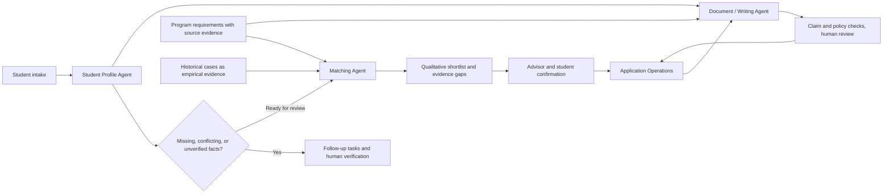

# Study Abroad Application System — Multi-Agent Case Study

An AI-assisted workflow prototype for preparing study-abroad applications. It connects student facts, sourced program requirements, qualitative program matching, writing assistance, and application tasks. This is a **sanitized architecture case study**; the working source repository and its data are private.

## The problem

An advisor must reconcile incomplete student information, changing program requirements, historical application evidence, and many document deadlines. A fluent recommendation is not enough: the system needs to show which facts support it, which facts need verification, and where a person must decide.

## Workflow

| Component | What it does | Boundary |
| --- | --- | --- |
| Student Profile Agent | Normalizes intake and creates tasks for missing, conflicting, or unverified facts. | An unverified field is not silently treated as a fact. |
| Program data and historical cases | Supply sourced requirements and empirical application evidence. | Historical outcomes do not override official requirements. |
| Matching Agent | Checks eligibility first, then produces qualitative categories and an evidence-aware shortlist. | No admission probability or automatic admission decision. |
| Application Operations | Turns a confirmed program into an application case, requirement snapshot, checklist, and tasks. | A person confirms the program; this module does not submit an application. |
| Document / Writing Agent | Builds fact and program packs, writing plans, draft versions, and review packets. | Unclear requirements or unsupported claims trigger review; drafts cannot submit themselves. |

## Synthetic walkthrough

The private prototype includes fictional student fixtures. I ran the Student Profile component with its fixed test date of 10 August 2026. The ordinary business-student fixture produced **one verification task**. The deliberately incomplete fixture produced **12 missing-information items, five conflicts, three verification items, and 20 follow-up tasks**. These are component outputs, not results from real applicants. The Student Profile and Document Agent test suites passed in this local check.

The next steps in the designed workflow are to resolve those tasks, compare the verified profile against sourced program requirements, have an advisor review the shortlist, and generate document versions from confirmed application cases. This case study does **not** claim that this whole path has passed an end-to-end production test.

## My contribution

I defined the product workflow and the boundaries between the agents, translated application work into explicit states and review points, specified evidence and safety rules, and used AI-assisted implementation and local tests to iterate on the prototype. This page describes the system-level work rather than claiming that I personally hand-wrote every module.

## Status and disclosure

- Prototype and synthetic test evidence only; no real student submission or measured admissions outcome.
- Cross-component integration has been tracked as partial, so this page does not present the workflow diagram as a verified end-to-end run.
- This public repository contains only a sanitized explanation. It contains no student records, historical case database, credentials, or copied private source code.
